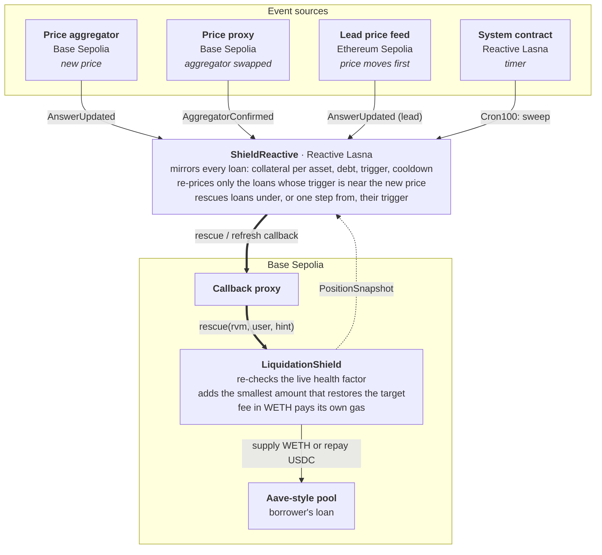

# Rebound: a self-funding liquidation shield on Reactive Omni

**Track:** Every Second Counts · **Networks:** Reactive Lasna + Base Sepolia (+ Ethereum Sepolia as a lead feed) · **Live dashboard:** [tryrebound.omthanage.dev](https://tryrebound.omthanage.dev/) ([`dashboard/`](dashboard/))

When a borrower's collateral price drops, an Aave-style loan can be liquidated in the same block: the liquidator
takes a bonus (5% on WETH in Aave V3). Rebound watches the price feed itself through a Reactive contract and acts
while the loan is still above 1.0. It requests a rescue when the loan crosses its trigger, or one price step
earlier when the price is falling fast. The rescue lands about seven Base blocks (1.4 s, median of 10 rounds on the
deployed version) after the price event, with no keeper bot and no server. It either adds collateral or repays debt,
by the smallest amount that restores the borrower's target. It charges **0.3% of the value it moves** (floor
0.0001 ETH, gas included). That fee is unwrapped to ETH inside the shield, where Reactive's callback proxy takes
the callback gas from it, so the destination side runs with no one topping it up. The Reactive side is not
self-funding yet: its lREACT is topped up by hand, and while it is empty no rescue is requested.

## In plain words

- **The problem.** You borrow USDC against WETH. If WETH falls far enough, anyone may repay part of your loan
  and take your WETH at a discount (Aave's liquidation bonus, about 5%). On Base, 37% of Aave liquidations land
  in the same block as the price update ([Signals and Spoils, 2026](https://arxiv.org/pdf/2606.03434)).
- **What Rebound does.** You leave some spare WETH (and, if you like, USDC) with Rebound and say when to act
  (a health factor, for example 1.15) and how far to recover (for example 1.40). When the price pushes your loan
  under 1.15, or is falling fast enough that the next update would, Rebound either adds your spare WETH as
  collateral or repays part of your debt with your spare USDC, just enough to bring it back to 1.40.
- **Why repaying is cheaper.** Repaying debt needs target ÷ liquidation threshold times less money than adding
  collateral: 1.40 ÷ 0.825 = 1.7 times less in the demo. A USDC reserve also doesn't lose value in the crash
  it is meant to cover.
- **What it costs.** 0.3% of what a rescue moves (at least 0.0001 WETH), against the ~5% you would lose to a
  liquidation, plus a small daily watch fee (0.00001 WETH by default) for keeping your loan watched.
- **Why it is fast and needs no bot.** No server watches your loan. A Reactive contract on Reactive Network is
  subscribed to the price feed's events, so the price change itself starts the rescue.
- **What you can always do.** Take your reserves back, change your trigger and target, switch mode, or stop
  protection. Rebound can only add collateral to your loan or repay your debt; it can never withdraw collateral or
  move your funds elsewhere.

## Why it matters

| Date | Event | Liquidated or lost | Source |
|---|---|---|---|
| 12 March 2020 | Black Thursday, MakerDAO zero-bid auctions | $8.32M of collateral sold for 0 DAI | [analysis](https://medium.com/@whiterabbit_hq/black-thursday-for-makerdao-8-32-million-was-liquidated-for-0-dai-36b83cac56b6) |
| 19 May 2021 | Market crash | $377M on Aave, Compound and Maker in a day | [Cointelegraph](https://cointelegraph.com/news/cointelegraph-consulting-defi-hit-by-a-tsunami-of-liquidations-in-may) |
| 5 August 2024 | Global sell-off | $237M to $253M on Aave V3 | [The Defiant](https://thedefiant.io/news/defi/crypto-crash-wipes-out-defi-borrowers-as-all-time-aave-v3-liquidations-double) |
| 10 October 2025 | Tariff crash | over $250M on Aave in a day | [Aave](https://aave.com/blog/historical-liquidations) |
| 31 Jan – 5 Feb 2026 | Sell-off | $429M on Aave, a record | [Aave](https://aave.com/blog/historical-liquidations) |
| 10 March 2026 | wstETH oracle capped 2.85% too low | $26M to $27M from 34 accounts | [The Block](https://www.theblock.co/post/393121/aave-oracle-glitch-wsteth) |

**What one liquidation costs, and what Rebound costs instead** (debt $100,000, LT 0.83, HF 1.08 after a drop):

| Outcome | Borrower pays |
|---|---|
| Liquidated just under HF 1.0 (50% close factor, 5% bonus) | about **$2,500** |
| Rebound adds collateral to reach HF 1.40 | top-up $38,554 (still yours), fee **$116** |
| Rebound repays debt to reach HF 1.40 | repays $22,857 of your debt, fee **$69** |

Sources and method: [`docs/research.md`](https://github.com/Om-Thanage/Rebound/blob/research/overnight/docs/research.md)
(on the `research/overnight` branch).

## Try it

Open the [dashboard](https://tryrebound.omthanage.dev/), pick **Adding collateral** or **Repaying debt**, and
press **Run a rescue** with a browser wallet on Base Sepolia (a little test ETH for gas). It calls `DemoLoan.run()`
(or `runWithMode(1)`), which resets the demo loan (WETH back to $2,000, the last rescue undone, HF 1.2) and drops
WETH in two steps in one transaction: $1,950 (HF 1.17, still above the 1.15 trigger) and $1,800 (HF 1.08). The
page walks through five steps as they happen. Step 4 shows ShieldReactive asking for the rescue at the $1,950
step, before the trigger was crossed, because the price was falling fast. One run a minute for everyone; anyone
can refill the demo's reserve with `DemoLoan.topUp()`.

**The demo loan** ([`0x4690…73f5`](https://base-sepolia.blockscout.com/address/0x46902207FaE37E608b858f59e8c8BfCACD7073f5)) is deliberately
small, so test funds last. Every run resets it to the same starting point before the crash:

| | Amount |
|---|---|
| Collateral | 0.004 WETH (about $8 at $2,000) |
| Debt | 5.50 USDC |
| Health factor | 1.20 at $2,000, 1.08 after the drop to $1,800; trigger 1.15, target 1.40 |
| Set aside for rescues | 0.003 WETH for adding collateral, 10 USDC for repaying debt |

A collateral rescue adds about 0.00119 WETH; a repay rescue pays back about 1.26 USDC. Each charges the 0.0001 WETH
fee floor, which comes out of the WETH reserve, so `topUp()` keeps it going.

## Protect your own loan (testnet)

Everything runs on Base Sepolia with test tokens: test WETH is wrapped from Base Sepolia ETH, and test USDC is
borrowed from the demo pool. You need [Foundry](https://getfoundry.sh) (`cast`) and a wallet with about
0.01 Base Sepolia ETH; `$KEY` is that wallet's private key, kept in your own shell or `.env`. Take the addresses
from `deployments.env` after a deploy.

```bash
RPC=https://sepolia.base.org
. ./deployments.env   # WETH, USDC, POOL, SHIELD, ...
ME=$(cast wallet address --private-key $KEY)
tx() { cast send "$@" --rpc-url $RPC --private-key $KEY; }

# 1. Get 0.008 test WETH and let the pool and the shield use it (and USDC, for repay mode)
tx $WETH "deposit()" --value 0.008ether
for spender in $POOL $SHIELD; do
  tx $WETH "approve(address,uint256)" $spender $(cast max-uint)
  tx $USDC "approve(address,uint256)" $spender $(cast max-uint)
done

# 2. Open a loan: 0.005 WETH collateral, borrow 7 USDC (HF about 1.18 at $2,000)
tx $POOL "supply(address,uint256,address,uint16)" $WETH 5000000000000000 $ME 0
tx $POOL "borrow(address,uint256,uint256,uint16,address)" $USDC 7000000 2 0 $ME

# 3. Protect it: act under HF 1.15, recover to 1.40, keep 0.003 WETH in reserve
tx $SHIELD "protect(uint64,uint64,uint256)" 1150000000000000000 1400000000000000000 3000000000000000

# 3b. Optional: rescue by repaying debt instead (keep the WETH reserve: it pays the fee)
tx $USDC "mint(address,uint256)" $ME 10000000                     # test USDC faucet
tx $SHIELD "depositRepayReserve(uint256)" 10000000
tx $SHIELD "configure(uint64,uint64,uint64,uint8)" 1150000000000000000 1400000000000000000 0 1

# 4. Check it any time
cast call $POOL "getUserAccountData(address)(uint256,uint256,uint256,uint256,uint256,uint256)" $ME --rpc-url $RPC  # last value = HF
cast call $SHIELD "protections(address)(uint128,uint128,uint64,uint64,uint64,uint64,uint64,uint8,bool)" $ME --rpc-url $RPC
```

The next price drop under your trigger rescues you. Anyone's **Run a rescue** on the dashboard moves the shared
test price to $1,800, which takes this example loan to about 1.06, so it is rescued in the same second as the
demo loan.

| You want to | Call |
|---|---|
| Add more WETH reserve | `protect(trigger, target, amount)` again with the extra amount |
| Add USDC for repay mode | `depositRepayReserve(amount)` |
| Set everything in one call | `setup(trigger, target, step, mode, wethAmount, usdcAmount)`: one snapshot, so one reactive transaction |
| Change when and how it acts | `configure(trigger, target, step, mode)`: mode 0 adds collateral, 1 repays debt, 2 repays first then adds; `step` > 0 rescues in stages of trigger + step |
| Take reserve back | `withdrawReserve(amount)` or `withdrawRepayReserve(amount)`; not while your loan is under its trigger |
| Stop protection | `unprotect()` returns both reserves at any time |
| Borrow more or add collateral yourself | do it on the pool, then `sync(yourAddress)` so the Reactive contract sees the new numbers |

On mainnet the shield would point at the real Aave V3 Pool and oracle. It only calls `getUserAccountData`,
`getConfiguration`, `supply(asset, amount, onBehalfOf, 0)` and `repay(asset, amount, 2, onBehalfOf)`, which Aave V3
has with the same signatures, and reads aToken balances. The reactive contract reads Chainlink's own
`AnswerUpdated` event (price in topic 1) and follows the feed when Chainlink swaps the aggregator behind its proxy.

## How it works



1. A borrower calls `protect(trigger, target, reserve)` on the shield (and optionally `depositRepayReserve` and
   `configure`). The shield emits `PositionSnapshot` with collateral per asset, liquidation thresholds, debt,
   trigger and cooldown. Loans that have never been active are not published.
2. `ShieldReactive` mirrors every snapshot. Single-asset loans go into buckets by the price at which they reach
   their trigger; loans with several collateral assets are checked on every tick.
3. On each `AnswerUpdated`, it checks only the buckets near the new price, highest risk first. It requests a
   `rescue(address,address,uint256)` callback for each loan under its trigger, and for each loan that would be
   under it if the price fell again by the same step (capped at 5%), passing that projected price as a hint. A
   tick has a gas budget (650k of Reactive's 900k limit); if a crash crosses more triggers than one tick can
   serve, the next tick carries on where it stopped.
4. A price update on the lead chain (Ethereum Sepolia) does the same, with the lead price as the hint, so the
   rescue can land before Base's own oracle moves.
5. `LiquidationShield.rescue` accepts only the callback proxy (`onlyServiceProvider`) carrying our reactive
   contract's address (`onlyCallbackSender`). It re-reads the live position, prices WETH at the hint (never more
   than 5% under the oracle), skips if it is healthy or in its 10 s cooldown, then repays and/or supplies the
   smallest amount that restores the goal. A short reserve gives a partial rescue.
6. The fee is unwrapped (`WETH.withdraw`) so it lands as native ETH; the callback proxy's `pay()` takes gas from
   that balance. `opsLedger()` and `feeBreakdown()` show fees, watch fees, outside funding, gas paid, skipped
   callbacks and fee-less rescues.
7. The shield emits a fresh snapshot, which clears the pending flag on Lasna. A rescue that never comes back stops
   blocking the loan after 60 s. Every `Cron100` tick sweeps a batch of loans and asks the shield to re-publish
   any whose mirror is a day old, since interest keeps adding to their debt.

## What is different

| | DeFi Saver / Instadapp | Reactive's CRON demo, ReacDEFI | Rebound |
|---|---|---|---|
| Trigger | off-chain bots | CRON (polling interval) / trigger HF | the price event itself, plus one price step early, plus a lead feed on another chain |
| Who runs it | the operator's bots | one contract per user (demo); ReacDEFI's service | one shared shield for every borrower, no bot |
| Rescue | repay (sells collateral) | add collateral, repay, or both | add collateral, repay, both, or in stages; smallest amount to the target |
| Fee | 0.05% + gas (DeFi Saver), 0.3–0.4% + gas (Instadapp) | not stated | 0.3% gas included, plus a small watch fee; shown on-chain |
| Funding | operator | topped up by hand | fees pay callback gas, shown on-chain |

Morpho's pre-liquidations take a different route: a softer liquidation band with a smaller bonus. Rebound avoids
the liquidation altogether and leaves the collateral with the borrower.

**Research it builds on:** Qin et al., *An Empirical Study of DeFi Liquidations* (IMC 2021): $807M liquidated in
28k events; Perez et al., *Liquidations: DeFi on a Knife-edge* (FC 2021): over 70% of liquidatable positions are
liquidated immediately, so a shield must act before HF 1.0; Sevim and Ferreira Torres, *Signals and Spoils*
(2026): liquidators use one chain's Chainlink update to predict another's, which is what the lead feed turns to the
borrower's side; Qin et al., *Mitigating DeFi Liquidations with Reversible Call Options* (Miqado, FC 2023): outside
top-ups cut liquidated collateral by 89.8% in simulation.

## Measured on live testnets

`script/bench.sh` resets the loan each round (price back to $2,000, collateral back to HF 1.2), drops WETH to
$1,800 (HF 1.08, under the 1.15 trigger) and counts Base blocks between the price transaction and the
`Rescued` event. At 200 ms a block, blocks × 0.2 s is the end-to-end latency. Results:
[`results/bench.csv`](results/bench.csv), summary in [`results/summary.txt`](results/summary.txt).

| Version | Rounds | Rescued | Median | p90 | Fastest | Slowest |
|---|---|---|---|---|---|---|
| Deployed (v4: v3 plus the CRON fix) | 10 | 10 | **1.4 s** (7 blocks) | 2.2 s | 0.8 s | 2.6 s |
| Third version ([`results/v3/`](results/v3/), the [review](docs/review.md) fixes) | 10 | 10 | 0.8 s (4 blocks) | 1.4 s | 0.6 s | 1.4 s |
| Second version ([`results/v2/`](results/v2/)) | 10 | 10 | 1.4 s (7 blocks) | 1.8 s | 1.0 s | 2.0 s |
| First version ([`results/v1/`](results/v1/)) | 20 | 20 | 1.2 s (6 blocks) | 1.6 s | 1.0 s | 2.0 s |

Every rescue lifted the health factor to 1.40. The last two runs went through without a gap. In the first two the
reactive contract ran out of lREACT partway (Reactive stops calling `react()` while a contract owes it); after a
`depositTo` the missing rounds were rerun. Runs vary by a few blocks with Lasna's load: v3 and v4 run the same
price path, and their medians are 0.8 s and 1.4 s.

That is three to thirteen blocks after the price update. Liquidators act in the update's own block, so Rebound's
protection comes from acting while HF is between the trigger and 1.0, and from the early request when the price is
falling fast, not from beating liquidators to a loan that is already liquidatable.

What this measures is latency on one price path: every round drops the loan to 1.08, still above 1.0, and the
dashboard demo posts both price steps in one transaction, so no rescue can land between them. It does not
measure how often a rescue prevents a liquidation across realistic price paths and crowded triggers (late,
partial and missed rescues included). That is the next experiment.

**Lead feed, live (second version):** `script/lead.sh 1900` moved WETH to $1,900 on Ethereum Sepolia first. The rescue landed on
Base 0.8 s after that update confirmed, **before Base's own oracle had moved** (it followed 10 s later).

**Self-funding (Base side),** from `opsLedger()` on the deployed shield after 13 rescues: 0.0013 ETH in fees against
0.000026 ETH of callback gas, about 50 times over; the shield owes the callback proxy nothing.

**Repay mode, live:** `DemoLoan.runWithMode(1)` ([price](https://base-sepolia.blockscout.com/tx/0xe13678e7baae652f3364b1c4ca99b2a0d431bff8ec1420e1bf645caf565928ed),
[rescue](https://base-sepolia.blockscout.com/tx/0x25491ee76fc96dcee74f5eddfd869995d72daf777e11236c998f101286db72c6)) was rescued
8 blocks later with no WETH added: `RescueDetail` shows 1.257 USDC repaid, the debt fell from 5.50 to 4.24 USDC and
the health factor rose from 1.08 to 1.40.

**CRON, live:** the first three versions subscribed to `CronN` from the Omni system contract (`0x8888…`), but
Reactive Network emits it from `0x0000000000000000000000000000000000fffFfF`, so the sweep never ran on Lasna. v4
subscribes there and ticks: `cronTicks` was 1 within two minutes of the deploy.

**Reactive side, measured:** read from the system contract's `reserves()` for ShieldReactive. Idle, with no price
moving, v4 spends about **0.017 lREACT per `Cron100` tick**, roughly 0.6 lREACT an hour (0.051 lREACT over five
minutes and three ticks); v2, whose CRON never fired, spent nothing idle. A slower CRON (`CRON_EVENT=Cron1000` in
`deploy.sh`) would cut that tenfold. One dashboard run (reset, two-step crash: three price events and two
loan snapshots) cost **0.111 lREACT** on the second version; the first version's simpler loop cost about 0.04. At the testnet faucet rate
(100 lREACT per ETH) 0.111 lREACT is 0.0011 ETH, above the 0.0001 ETH fee floor; at the mid-November 2026 market
price of REACT (about $0.0023) it is about $0.0003, which the floor covers. Watching costs gas on every price event
while fees only arrive on rescues; the daily watch fee and the trigger buckets are there for that gap. Bridging fee
income to REACT and calling `depositTo` is still manual.

## Deployed contracts

| Contract | Network | Address |
|---|---|---|
| ShieldReactive | Reactive Lasna (5318007) | [`0xDF7afB41ba5C15aE5d3F7A3FA44F352CDc2D3984`](https://lasna.reactscan.net/address/0xDF7afB41ba5C15aE5d3F7A3FA44F352CDc2D3984) |
| LiquidationShield | Base Sepolia (84532) | [`0xd9394D6847f0269C0485853AEc506450C1bB4ca0`](https://base-sepolia.blockscout.com/address/0xd9394D6847f0269C0485853AEc506450C1bB4ca0) |
| DemoLoan | Base Sepolia | [`0x46902207FaE37E608b858f59e8c8BfCACD7073f5`](https://base-sepolia.blockscout.com/address/0x46902207FaE37E608b858f59e8c8BfCACD7073f5) |
| MockAavePool | Base Sepolia | [`0xB106Ec7B690e79BF7BCef36a8bf9Bef37D22Ee29`](https://base-sepolia.blockscout.com/address/0xB106Ec7B690e79BF7BCef36a8bf9Bef37D22Ee29) |
| MockAaveOracle | Base Sepolia | [`0x7799A3187B3DA9F48d7bf54f64FBBB9241f24FFc`](https://base-sepolia.blockscout.com/address/0x7799A3187B3DA9F48d7bf54f64FBBB9241f24FFc) |
| WETH/USD feed (aggregator / proxy) | Base Sepolia | [`0x83139b4e2891b509Dc68FE66696925e1C3f1427E`](https://base-sepolia.blockscout.com/address/0x83139b4e2891b509Dc68FE66696925e1C3f1427E) |
|  |  | [`0x728d466C8447f9D414E974Eefba55dc5aa3DEf03`](https://base-sepolia.blockscout.com/address/0x728d466C8447f9D414E974Eefba55dc5aa3DEf03) |
| WBTC/USD feed (aggregator / proxy) | Base Sepolia | [`0x91fB170866F88A16F418772c8f9a6f0f6dbd196C`](https://base-sepolia.blockscout.com/address/0x91fB170866F88A16F418772c8f9a6f0f6dbd196C) |
|  |  | [`0xBD987b86A62acC2Ba21B86C0d6EBb8849b14bb63`](https://base-sepolia.blockscout.com/address/0xBD987b86A62acC2Ba21B86C0d6EBb8849b14bb63) |
| Test WETH | Base Sepolia | [`0x90fe15bca7d1A697c13971EfF8b792E5A814Ed19`](https://base-sepolia.blockscout.com/address/0x90fe15bca7d1A697c13971EfF8b792E5A814Ed19) |
| Test WBTC | Base Sepolia | [`0x2EC5CcE4BAA0cD96280350d20411F882227941eb`](https://base-sepolia.blockscout.com/address/0x2EC5CcE4BAA0cD96280350d20411F882227941eb) |
| Test USDC | Base Sepolia | [`0x151212a982AB75a300EdF6104A03E0556231E202`](https://base-sepolia.blockscout.com/address/0x151212a982AB75a300EdF6104A03E0556231E202) |
| Lead WETH/USD feed | Ethereum Sepolia (11155111) | [`0x1d3cc73c0B805683fd7910f63BCf360e2a50D26E`](https://eth-sepolia.blockscout.com/address/0x1d3cc73c0B805683fd7910f63BCf360e2a50D26E) |

Callback proxy on Base Sepolia: `0x476F44b11F5C942c58f4c8E3d0300E5710743585`. Every Base Sepolia and Ethereum
Sepolia contract above is source-verified on Sourcify (exact match). Earlier versions' addresses are in
[`deployments.v1.env`](deployments.v1.env), [`deployments.v2.env`](deployments.v2.env) and
[`deployments.v3.env`](deployments.v3.env).

### Full-loop transactions (origin event → callback)

| Loop | 1. Price event | 2. Reactive tx, `RescueRequested` (Lasna) | 3. Rescue callback (Base) | Latency |
|---|---|---|---|---|
| Benchmark round 1 | [`0x1154…45e8`](https://base-sepolia.blockscout.com/tx/0x1154a8bccffc7bc814c4f534734a1e22208ffd762dfb2a43605ffe9b412f45e8) (Base) | [`0x41be…f93d`](https://lasna.reactscan.net/tx/0x41bec2087cc6b637eba802e3b965394f57c532f123792eef81247679e919f93d) | [`0x70aa…7852`](https://base-sepolia.blockscout.com/tx/0x70aae3a9b00b7a175d3989659bbd7079e1ccaa226d5de7dcd71d7398a03a7852) | 7 Base blocks (1.4 s) |
| `script/demo.sh 1800` | [`0x8bf9…88ef`](https://base-sepolia.blockscout.com/tx/0x8bf9e69723cdc95da1d05ecf8ae906a10722e1673de400c3b714f694405b88ef) (Base) | [`0x8e96…c570`](https://lasna.reactscan.net/tx/0x8e967eaac1d173b23ced66e0a53a8b264a35b24f5329127471ed28a22aefc570) | [`0xa08d…abc3`](https://base-sepolia.blockscout.com/tx/0xa08d6b86ae6d4340c3f54df6a45e5fb1c4ad2b678da17e5fb8b7c3cf482fabc3) | 7 Base blocks (1.4 s) |
| `DemoLoan.runWithMode(1)`, repay | [`0xe136…28ed`](https://base-sepolia.blockscout.com/tx/0xe13678e7baae652f3364b1c4ca99b2a0d431bff8ec1420e1bf645caf565928ed) (Base) | [`0x87ab…f04c`](https://lasna.reactscan.net/tx/0x87aba42cfdfde28c47c886757c5972a88cb961693b8b9eee1d722b93f223f04c) | [`0x2549…72c6`](https://base-sepolia.blockscout.com/tx/0x25491ee76fc96dcee74f5eddfd869995d72daf777e11236c998f101286db72c6) | 8 Base blocks (1.6 s) |
| Lead feed (second version) | [`0x3205…cd00`](https://eth-sepolia.blockscout.com/tx/0x3205623dc5126c391c9201481ea3140c61edffeabd4f79dcf3a886f67465cd00) (Ethereum Sepolia) | [`0xd442…e33e`](https://lasna.reactscan.net/tx/0xd442247264309eb66b637cfbf690b1ae017007e71b80610a38f85ecc1d60e33e) | [`0x8b47…9205`](https://base-sepolia.blockscout.com/tx/0x8b4712bdb4e198c7da3111e8bfd2a3a1347182c691e41a740ee0e6dadfc29205) | before Base's oracle moved |

Every benchmark round's price, Lasna and rescue transactions are in `results/bench.csv`.

## Run it yourself

Needs [Foundry](https://getfoundry.sh), `jq`, and a testnet wallet with Base Sepolia ETH, a little Ethereum
Sepolia ETH (for the lead feed), and Lasna lREACT (send Sepolia ETH to the faucet
`0x9b9BB25f1A81078C544C829c5EB7822d747Cf434`, 1 ETH → 100 lREACT).

```bash
cp .env.example .env              # then put your testnet PRIVATE_KEY in .env (or point ENV_FILE at another file)
forge test                        # 55 tests: modes, early trigger, lead feed, buckets, CRON, gas bounds, mock locks, fuzz
bash script/deploy.sh             # predicts every address, deploys lead feed, Lasna, then Base; writes deployments.env
bash script/status.sh             # health check: lREACT runway in demo runs, CRON firing, ledger, demo loan
node script/export-deployment.mjs # points the dashboard at the new deployment
bash script/demo.sh 1800          # opens and protects a loan, crashes WETH, times the rescue
bash script/lead.sh 1900          # moves the lead feed first: the rescue lands before Base's oracle moves
bash script/bench.sh 20           # 20 timed rounds -> results/bench.csv (START=n continues a run)
node script/backfill-bench.mjs    # fills to_reactive_s for rounds that have a Lasna block but no value
node script/export-bench.mjs      # feeds the dashboard's speed section
node script/export-rescues.mjs    # snapshots every rescue for the dashboard's list (it adds newer ones live)
```

Open the dashboard over any static server (for example `npx serve dashboard`). It reads the contracts over
Base Sepolia's and Lasna's public RPCs and refreshes every 10 seconds. The rescue list comes in three layers:
the history shipped in `data/rescues.json`, one Blockscout call per page load for anything after it, and the RPC
for new blocks; if Blockscout fails, it reads up to a day over RPC and says which blocks it could not load.

## Submission checklist

| The brief asks for | Where it is |
|---|---|
| Public repository | this repository (MIT licence for our code; libraries keep their own) |
| Deployed contract addresses | [Deployed contracts](#deployed-contracts), all source-verified |
| Transaction hashes for the full loop, origin event to callback | [Full-loop transactions](#full-loop-transactions-origin-event--callback) |
| Demo video under three minutes | link to be added |
| Track: Every Second Counts on Base Sepolia | Reactive Lasna + Base Sepolia; latency in [Measured on live testnets](#measured-on-live-testnets) |
| Built during the event | every commit is from November 2026, inside the event; `forge-std` and `reactive-lib-omni` are dependencies |
| Timestamps, not block counts, for timers on Base | the shield's 10 s cooldown, the 60 s pending timeout and DemoLoan's 60 s cooldown use timestamps |

## Repository

| Path | What |
|---|---|
| `src/LiquidationShield.sol` | destination contract: reserves, modes, rescue maths, fee → gas, watch fee, ops ledger |
| `src/ShieldReactive.sol` | reactive contract: mirrors loans, buckets, early and lead-feed requests, aggregator following, CRON |
| `src/DemoLoan.sol` | a protected loan anyone can reset and crash in two steps, in either mode |
| `src/mocks/` | lending pool with Aave V3's signatures and maths (two collateral assets), Chainlink-style feeds, test tokens |
| `test/Shield.t.sol` | 55 tests with a mocked system contract and callback proxy |
| `script/` | deploy, demo, lead feed, benchmark, exports |
| `dashboard/` | the live page |

## Fixes after v4 (in the code, not yet deployed)

An outside review of `f38a97a` found five problems. All five are fixed here with a test each (55 tests). The
dashboard fix is live; the contract fixes take effect at the next deploy, so the deployed v4 still has them.

| Problem | Fix | Live? |
|---|---|---|
| A partial rescue charged the 0.3% fee on the full top-up the loan needed, not on what the reserve could supply (0.003 WETH on a 0.007 WETH top-up) | The top-up and its fee are sized together, so the fee is 0.3% of what moves (or the 0.0001 ETH floor) | Next deploy |
| The snapshot counted every aToken balance as collateral; Aave leaves out assets the borrower switched off and applies eMode thresholds, so the mirror could think a loan was safer than it is | Thresholds in the snapshot are scaled so the mirror's health factor matches the pool's own `getUserAccountData` | Next deploy |
| An early request from a falling WBTC price sent a WBTC price as the hint, which the shield reads as a WETH price, so the rescue was skipped | Early requests come only from WETH moves; WBTC loans are rescued when they cross the trigger | Next deploy |
| A tick that ran out of gas in a crowded bucket restarted at the front of that bucket, so later loans waited for the sweep | The scan remembers its place inside the bucket | Next deploy |
| The dashboard said "safe again" after every rescue, even a partial one | It reads the health factor after the rescue: at target, above the trigger, under the trigger, or under 1.0 | Live |

## Limits

- The pool is a mock with Aave V3's interface, because Aave's testnet oracle price can't be moved for a demo.
  Anyone may move the test price through the mock oracle (the demo depends on it); everything else on the mocks
  (swapping a feed's aggregator, oracle sources, listing collateral, the borrow rate) is the deployer's alone.
- Collateral top-ups and fees are in WETH. Other collateral assets are watched and priced, but a rescue tops up
  with WETH.
- The price hint (projected or lead price) is trusted up to 5% under the oracle. A manipulated lead feed can make
  a borrower top up early with their own funds, plus one fee; it cannot move funds anywhere else.
- The snapshot matches the pool's health factor at today's prices, spread over all assets. A real-Aave version
  should read each asset's collateral flag and the borrower's eMode category, and be checked against a Base fork.
- On mainnet, the REACT that pays for Reactive execution would be bought with fees and sent across with
  `depositTo`; on testnet the reactive contract is funded by hand.
- A crash that crosses more triggers than one tick's gas budget is served over the following ticks or CRON sweeps,
  highest risk first.
